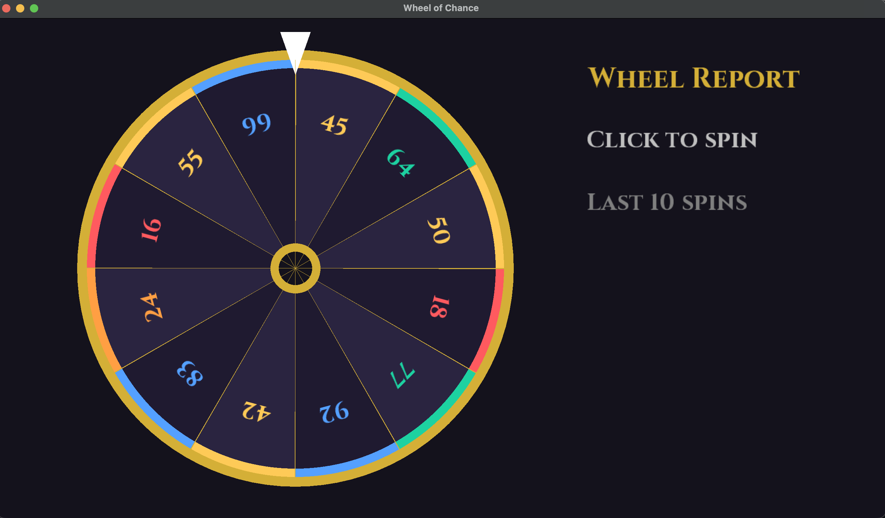

# Wheel of Chance

A small libGDX desktop app: a wheel of 12 random point values (0–100). Click to spin; it turns several revolutions, slows, and stops on a value. A peg-click sound plays as slices pass the pointer, and a report on the right shows the result and the last 10 spins.

Values are color-grouped: 0–19 red, 20–39 orange, 40–59 yellow, 60–79 green, 80–100 blue.



## Run

Requires JDK 17.

```bash
./gradlew run
```

### Rigged wheel (guessing experiments)

Pass a comma-separated list of values; every spin lands on one of them, chosen at random. The values are placed on the wheel if they aren't already there (max 12, each 0–100).

```bash
./gradlew run -PpredeterminedValues=10,70
./gradlew run -PpredeterminedValues="10, 70"   # quote it if you use spaces
```

Note the capital `-P`; lowercase `-p` is Gradle's project-directory flag.

## Test

```bash
./gradlew test
```

## Credits

Text uses [Cinzel](https://fonts.google.com/specimen/Cinzel) (SIL Open Font License, see `src/main/resources/OFL.txt`).
